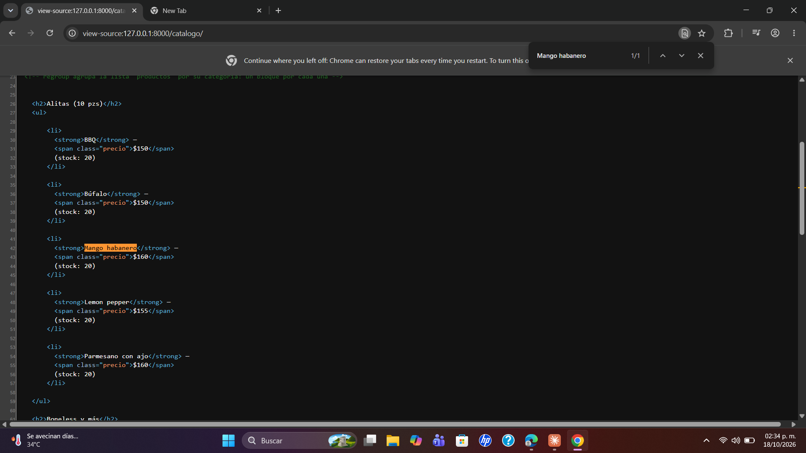
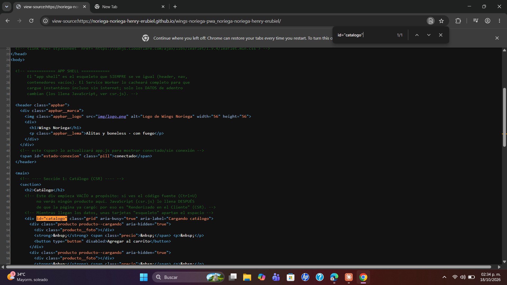
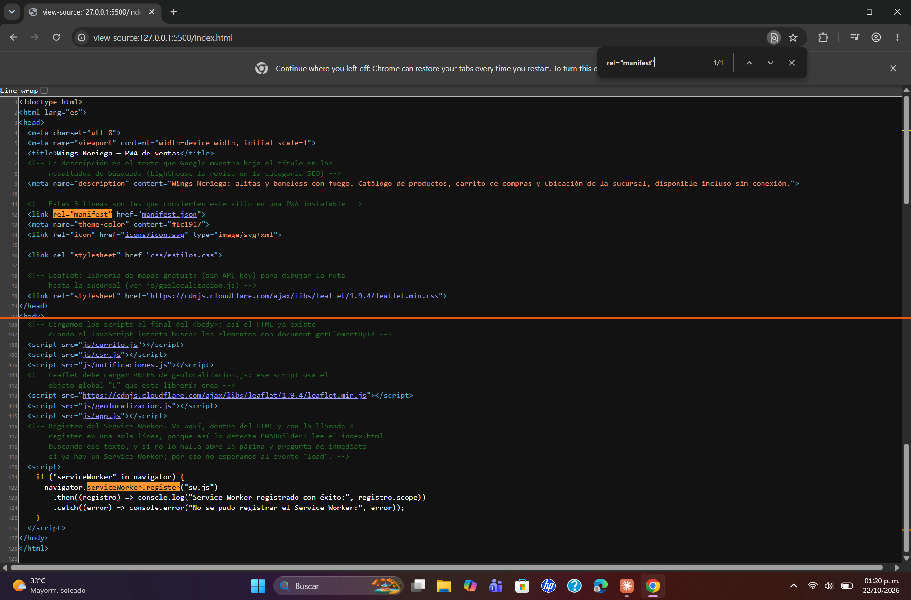
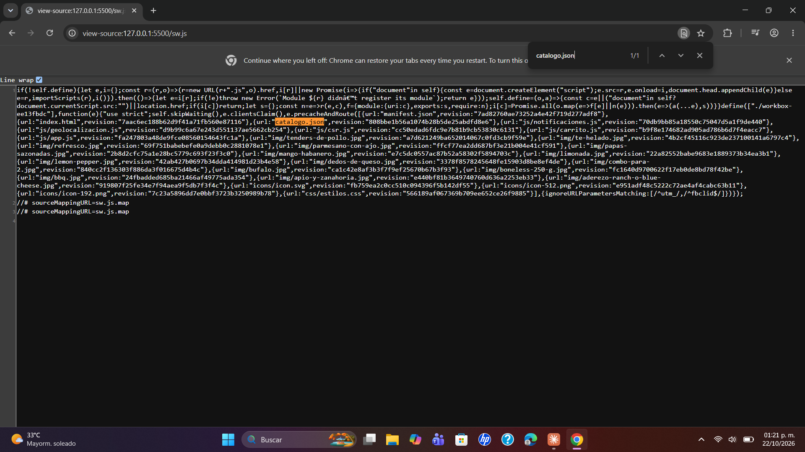

# Wings Noriega — PWA de ventas

| Dato | Valor |
|---|---|
| **Alumno** | NORIEGA NORIEGA HENRY ERUBIEL |
| **Grupo** | ING10-1 |
| **Negocio · giro** | Wings Noriega · Alitas y boneless |
| **URL del repositorio** | https://github.com/Noriega-Noriega-Henry-Erubiel/wings-noriega-pwa_noriega-noriega-henry-erubiel |
| **URL de GitHub Pages** | https://noriega-noriega-henry-erubiel.github.io/wings-noriega-pwa_noriega-noriega-henry-erubiel/ |

## Historial de avances

| Avance | Hash del commit entregado | Fecha |
|---|---|---|
| 1 | 9b1ab446a03252a90e270c11bf8281779f170aa2 | 11/10/2026 |
| 2 | 4f4a0d4be4a52510218852783bc6dcf712c36a81 | 18/10/2026 |
| 3 | 57b589e9f3f21b63a76ef97817788e7be33e3ff4 | 25/10/2026 |
| 4 | (se escribe en el reporte PDF) | 01/11/2026 |

## Comparación SSR vs CSR

### SSR (Django): los productos llegan escritos en el HTML

### CSR (JavaScript): el div del catálogo llega vacío

## Funciones PWA (avance 3)

### index.html: manifest y registro del Service Worker activos

### sw.js: Workbox precachea el catálogo y las fotos

